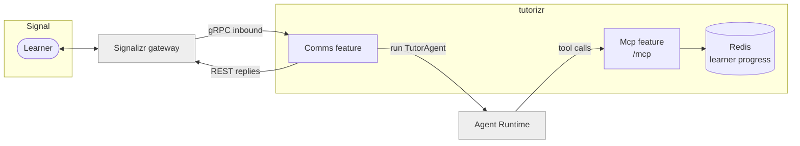

# tutorizr

A tutor that you talk to in a Signal group. It answers through the CasCap Agent Runtime and keeps
track of your vocabulary and mistakes.

German is the proof of concept: the first tutor definition teaches German from CEFR A1 to B2,
aiming at the Goethe-Institut exams. The host itself is not tied to a language. The subject,
levels and teaching style live in the agent definition, so the same deployment could tutor another
topic with a different definition. The learner tools are language-oriented (vocabulary, CEFR level,
mistakes); no further work towards other subjects is planned yet.

> Status: early. The Signal chat path, the learner tools, German voice and the deployment chart
> exist; retrieval of CEFR word lists is not yet in place.

## Service Architecture



- **Comms** subscribes to the chat group through Signalizr, sends each message (including voice
  notes transcribed by speech-to-text) to the `TutorAgent` definition in the Agent Runtime, and
  replies with text and, optionally, synthesised speech (German in the proof of concept).
- **Mcp** serves the tutor's tools to the Agent Runtime at `/mcp`, protected by Basic
  authentication and rejecting browser `Origin` headers.

## Tools

| Tool | Hints | Purpose |
| --- | --- | --- |
| `get_learner_profile` | read-only | Target and estimated level, vocabulary backlog and mistake count |
| `set_learner_level` | idempotent write | Store the learner's estimated CEFR level |
| `add_vocabulary` | idempotent write | Add a term to spaced-repetition practice, keeping existing progress |
| `get_due_vocabulary` | read-only | Terms due for review, longest overdue first |
| `record_vocabulary_review` | write | Record an answer and schedule the next review (Leitner boxes 1 to 5) |
| `record_mistake` | write | Log a mistake, its correction and the rule |
| `get_recent_mistakes` | read-only | Most recent mistakes, optionally of one kind |

When `Comms` runs in the same process, the shared poll tools from `CasCap.Comms.AI`
(`create_poll`, `close_poll`, `get_poll_status`) are also served, so the tutor can ask
multiple-choice questions in the chat. The Agent Runtime withholds every tool that is not
read-only unless the definition names it explicitly.

The store holds a single learner; every member of the chat group shares one profile.

## Configuration

Base values live in [appsettings.json](appsettings.json) with public-safe placeholders; local
overrides belong in the gitignored `appsettings.Local.json` and `appsettings.Local.Development.json`.

| Section | Purpose |
| --- | --- |
| `CasCap:FeatureConfig:EnabledFeatures` | `Comms`, `Mcp` or both |
| `CasCap:CachingConfig` | Redis connection; required |
| `CasCap:ApiAuthConfig` | Basic credentials for `/mcp` |
| `CasCap:TutorConfig` | Target level, Redis keys and mistake retention |
| `CasCap:CommsConfig` | Chat and monitor group names, agent name and session |
| `CasCap:SignalizrClientConfig` | Signalizr REST and gRPC addresses and subscriber name |
| `CasCap:AgentRuntimeClientOptions` | Agent Runtime base address |
| `CasCap:AgentRuntimeAzureAuthConfig` | Microsoft Entra execution identity; loaded from Key Vault prefix `AgentRuntime--Tutorizr--Exec` |
| `CasCap:SpeechToTextConfig`, `CasCap:TextToSpeechConfig` | Voice notes and spoken replies; disabled by default |

### Voice

Voice notes are transcribed and answered like text. With `TextToSpeechConfig:Mode` set to
`MatchInbound`, a reply to a voice note is also spoken. The tracked defaults are German-first:

- **Speech-to-text:** Azure AI Speech chooses between the `AzureLocales` candidates `de-DE` and
  `en-GB`, so a learner can switch to English for a question. The Whisper providers use `Language`
  (`de`) instead.
- **Text-to-speech:** `de-DE-SeraphinaMultilingualNeural` speaks German natively and can also read
  the English explanations the tutor gives on request.
- **Authentication:** both Azure AI Speech clients use the host's `AzureAuthConfig` credential,
  which needs the Cognitive Services Speech User role on the Speech account; there is no key.
- **Privacy:** audio is never forwarded to the Agent Runtime, only the transcript. Transcripts reach
  the monitor group only when `CommsConfig:EchoTranscriptToDebugChat` is enabled.

### Configuration Examples

Minimal local development, with Redis on `localhost` and Key Vault disabled
(see [appsettings.Development.json](appsettings.Development.json)):

```json
{
  "AppConfig": { "KeyVaultName": "skip" },
  "CasCap": {
    "FeatureConfig": { "EnabledFeatures": "Mcp" },
    "ApiAuthConfig": { "Username": "demo", "Password": "demo" }
  }
}
```

Chat with voice, pointing at a gateway and runtime:

```json
{
  "CasCap": {
    "FeatureConfig": { "EnabledFeatures": "Comms,Mcp" },
    "SignalizrClientConfig": {
      "BaseAddress": "http://signalizr.example.svc",
      "GrpcAddress": "http://signalizr.example.svc:5001"
    },
    "AgentRuntimeClientOptions": { "BaseAddress": "http://agent-runtime.example.svc" },
    "SpeechToTextConfig": {
      "Mode": "Enabled",
      "Provider": "Azure",
      "AzureEndpoint": "https://speech.example.com/"
    },
    "TextToSpeechConfig": {
      "Mode": "MatchInbound",
      "Provider": "AzureSpeech",
      "AzureSpeechEndpoint": "https://speech.example.com/"
    }
  }
}
```

## Development

Debug builds reference adjacent checkouts of `CasCap.Common`, `CasCap.Api.Azure`,
`CasCap.Api.Voice`, `signalizr` and `agentizr` on the same branch.

```powershell
dotnet build tutorizr.Debug.slnx
dotnet test --project src/CasCap.App.Server.Tests/CasCap.App.Server.Tests.csproj
```

`deploy.ps1` and `build.ps1` forward to the shared container workflow scripts. Release builds
cannot yet resolve the Comms AI responder from a published package.

## Privacy

Learner content — vocabulary, mistakes and chat text — stays in Redis and the Agent Runtime
session and is never logged. Monitor diagnostics exclude message content unless
`CommsConfig:MonitorContentEnabled` is switched on.

## License

Released under the [MIT License](LICENSE).
