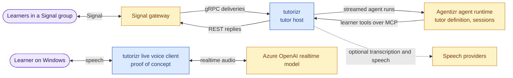

# tutorizr

tutorizr is a subject-agnostic, agentic tutor built on the [Agentizr agent runtime](https://github.com/f2calv/agentizr).
The tutor is an Agentizr agent: its teaching behaviour, model and session live in an agent definition
published to the runtime, so the same host can tutor any language, school subject, hobby or skill by
publishing a different definition. tutorizr supplies the parts a runtime does not own: the channels
a learner reaches the tutor through and the learner-progress tools the tutor calls.

- **Chat and voice notes:** a .NET 10 host relays a Signal group's conversation, including transcribed
  voice notes, to the runtime through the [Comms pipeline](https://github.com/f2calv/signalizr/blob/1.2.0/src/CasCap.Comms.AI/README.md).
- **Learner progress:** the same host exposes learner-progress tools over Model Context Protocol (MCP),
  backed by Redis, which the runtime calls during a lesson.
- **Live voice:** a Windows .NET MAUI client holds continuous, interruptible voice conversations with an
  Azure OpenAI realtime model. It currently connects directly; moving call setup, instructions and tools
  into Agentizr's realtime voice calls is in progress in [agentizr#29](https://github.com/f2calv/agentizr/pull/29).

The first example tutor is a German language tutor, and today's learner tools model language
learning: levels on the CEFR scale, spaced-repetition vocabulary and categorised mistakes. Nothing in
the runtime integration, channels or voice path is specific to German or to languages. This
repository ships no tutor definition, model, word lists or exam material.

## Projects

| Unit | Purpose | Availability |
| --- | --- | --- |
| [Application host](src/CasCap.App.Server/README.md) | Signal communications and authenticated learner MCP tools | Release uses published packages; Debug uses adjacent sources |
| [Host tests](src/CasCap.App.Server.Tests/README.md) | Offline tool, scheduling and annotation checks | 15 methods, 22 source-declared cases |
| [Realtime conversation](src/CasCap.App.Realtime/Services/RealtimeConversation.cs) | Platform-neutral GA Realtime WebSocket session: streaming, interruption and truncation | Debug solution only; proof of concept |
| [Live voice client](src/CasCap.App.Maui/Pages/ConversationPage.xaml.cs) | Windows .NET MAUI app with Start, Mute and End controls | Debug solution only; proof of concept |
| [Kubernetes chart](charts/tutorizr/README.md) | Single-subscriber workload configuration | Published OCI chart; authentication required; defaults to zero replicas |

## Run the Learner Tools Locally

Use the .NET 10 SDK and the [local Compose dependency](docker-compose.yml), or an existing dedicated
development Redis instance. Release builds resolve every dependency from
NuGet; Debug builds instead use adjacent source checkouts, as described in the
[host development guide](src/CasCap.App.Server/README.md#development).

Merge the following into the gitignored root `appsettings.Local.Development.json` before starting
the host. These are local-only example credentials, not deployment credentials:

```json
{
  "AppConfig": { "KeyVaultName": "skip" },
  "CasCap": {
    "FeatureConfig": { "EnabledFeatures": "Mcp" },
    "CachingConfig": {
      "RemoteCacheConnectionString": "localhost:6379,abortConnect=false"
    },
    "ApiAuthConfig": { "Username": "demo", "Password": "demo" }
  }
}
```

From the repository root:

```powershell
docker compose up -d --wait
$env:ASPNETCORE_ENVIRONMENT = "Development"
dotnet run --project .\src\CasCap.App.Server\CasCap.App.Server.csproj --configuration Debug --no-launch-profile -- --urls http://localhost:5080
```

An MCP client can then connect to `http://localhost:5080/mcp` with HTTP Basic authentication.
`/healthz` is anonymous. This path starts no Signal subscriber and requires no cloud provider.
The [host README](src/CasCap.App.Server/README.md) gives the tool contract, configuration precedence
and full chat prerequisites.

## System Context

tutorizr gives an Agentizr tutor agent its channels and its learner-progress tools. The
[architecture drilldown](docs/architecture.md) opens this box into its containers and components
and describes the artifact publication flow.



`Comms` and `Mcp` can run independently or together. Full chat requires a configured gateway group,
runtime agent definition/session and runtime authentication where enforced. Run only one Comms
subscriber for the group, with non-overlapping rollouts. When both features are enabled, the host
also exposes the shared poll tools; MCP-only mode exposes just the seven learner tools.

The live voice client currently uses a local prompt and no learner tools. Once Agentizr brokers
realtime calls, the client sends only its WebRTC offer to the runtime, which applies the same tutor
definition and calls the same learner tools as the chat path.

## Subjects and the Example Tutor

| Layer | Subject-specific? | Where it is defined |
| --- | --- | --- |
| Teaching behaviour, persona and curriculum | Yes, per tutor | The tutor's Agentizr agent definition, published with [`IAgentDefinitionAdminClient`](https://github.com/f2calv/agentizr/blob/1.4.0/src/CasCap.AgentRuntime.Client/Abstractions/IAgentDefinitionAdminClient.cs) |
| Conversation turns and sessions | No | [`IAgentRuntimeClient`](https://github.com/f2calv/agentizr/blob/1.4.0/src/CasCap.AgentRuntime.Client/Abstractions/IAgentRuntimeClient.cs), called by the [Comms responder](https://github.com/f2calv/signalizr/blob/1.2.0/src/CasCap.Comms/Abstractions/ICommsResponder.cs) |
| Chat, voice notes and live voice | No | Signal through [signalizr](https://github.com/f2calv/signalizr); speech through [`IVoiceTranscriptionService`](https://github.com/f2calv/CasCap.Api.Voice/blob/0.2.3/src/CasCap.Api.Voice/Abstractions/IVoiceTranscriptionService.cs) and [`IVoiceSynthesisService`](https://github.com/f2calv/CasCap.Api.Voice/blob/0.2.3/src/CasCap.Api.Voice/Abstractions/IVoiceSynthesisService.cs); the live voice client |
| Learner-progress tools | Language learning today | [`TutorMcpQueryService`](src/CasCap.App.Server/Services/TutorMcpQueryService.cs) over [`ILearnerStore`](src/CasCap.App.Server/Abstractions/ILearnerStore.cs): CEFR levels, spaced-repetition terms and mistakes |

Spaced repetition and mistake tracking suit any subject with facts to recall, such as a second
language, anatomy terms or chess openings. The CEFR level scale is language-specific; a tutor for
another kind of subject uses the tools without relying on levels, or needs a further tool set.

## Voice and Data Boundaries

Both speech modes are disabled in [the tracked settings](appsettings.json). Enable voice only with
the selected backend and required native audio tooling configured. Transcription supports Whisper
ASR, whisper.cpp or Azure AI Speech; spoken replies support Azure Speech, Azure OpenAI or Piper.
Other synthesis enum values are not implemented adapters. Follow the
[voice provider and runtime guide](https://github.com/f2calv/CasCap.Api.Voice/blob/main/src/CasCap.Api.Voice/README.md)
instead of treating a provider name as a deployed service.

Successful voice transcription replaces the agent prompt; the audio is not forwarded to the runtime
by this path. Chat text and transcripts reach the runtime, learner tools persist content in Redis,
and audio/text reaches the selected speech backend. Local learner tools do not log learner content.
The separate communications pipeline can disclose content to the operator's monitor group when
`MonitorContentEnabled` or `EchoTranscriptToDebugChat` is enabled; both default to `false`.

The live voice client streams microphone audio to Azure OpenAI only while a session is active and
shows transcripts transiently. It neither logs nor stores audio or transcripts.

## License

[MIT](LICENSE).
