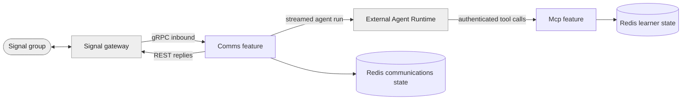

# tutorizr

tutorizr is a .NET 10 Signal-group tutor host that sends conversations to a separately operated
Agent Runtime and exposes learner-progress tools over Model Context Protocol (MCP).
It stores one shared learner's vocabulary, estimated CEFR level and mistakes in Redis.

The tools are German-language oriented, but lesson generation and teaching instructions belong to
the externally supplied agent definition. This repository does not ship a tutor definition, model,
CEFR word-list retrieval or exam-content collection.

## Projects

| Unit | Purpose | Availability |
| --- | --- | --- |
| [Application host](src/CasCap.App.Server/README.md) | Signal communications and authenticated learner MCP tools | Source-based Debug development; Release dependency wiring is incomplete |
| [Host tests](src/CasCap.App.Server.Tests/README.md) | Offline tool, scheduling and annotation checks | 14 methods, 21 source-declared cases |
| [Kubernetes chart](charts/tutorizr/README.md) | Single-subscriber workload configuration | Source chart; defaults to zero replicas |

## Run the Learner Tools Locally

Use the .NET 10 SDK and an existing Redis instance. Debug builds also need adjacent
`CasCap.Common`, `CasCap.Api.Azure`, `CasCap.Api.Voice`, `signalizr` and `agentizr` source checkouts
in the layout described in the [host development guide](src/CasCap.App.Server/README.md#development).
Disabling Comms at runtime does not remove those compile-time dependencies.

Merge the following into the gitignored root `appsettings.Local.Development.json` before starting
the host. These are local-only example credentials, not deployment credentials:

```json
{
  "AppConfig": { "KeyVaultName": "skip" },
  "CasCap": {
    "FeatureConfig": { "EnabledFeatures": "Mcp" },
    "CachingConfig": {
      "RemoteCacheConnectionString": "localhost:6379,abortConnect=false"
    },
    "ApiAuthConfig": { "Username": "demo", "Password": "demo" }
  }
}
```

From the repository root:

```powershell
$env:ASPNETCORE_ENVIRONMENT = "Development"
dotnet run --project .\src\CasCap.App.Server\CasCap.App.Server.csproj --configuration Debug --no-launch-profile -- --urls http://localhost:5080
```

An MCP client can then connect to `http://localhost:5080/mcp` with HTTP Basic authentication.
`/healthz` is anonymous. This path starts no Signal subscriber and requires no cloud provider.
The [host README](src/CasCap.App.Server/README.md) gives the tool contract, configuration precedence
and full chat prerequisites.

## Service Architecture



`Comms` and `Mcp` can run independently or together. Full chat requires a configured gateway group,
runtime agent definition/session and runtime authentication where enforced. Run only one Comms
subscriber for the group, with non-overlapping rollouts. When both features are enabled, the host
also exposes the shared poll tools; MCP-only mode exposes just the seven learner tools.

## Voice and Data Boundaries

Both speech modes are disabled in [the tracked settings](appsettings.json). Enable voice only with
the selected backend and required native audio tooling configured. Transcription supports Whisper
ASR, whisper.cpp or Azure AI Speech; spoken replies support Azure Speech, Azure OpenAI or Piper.
Other synthesis enum values are not implemented adapters. Follow the
[voice provider and runtime guide](https://github.com/f2calv/CasCap.Api.Voice/blob/main/src/CasCap.Api.Voice/README.md)
instead of treating a provider name as a deployed service.

Successful voice transcription replaces the agent prompt; the audio is not forwarded to the runtime
by this path. Chat text and transcripts reach the runtime, learner tools persist content in Redis,
and audio/text reaches the selected speech backend. Local learner tools do not log learner content.
The separate communications pipeline can disclose content to the operator's monitor group when
`MonitorContentEnabled` or `EchoTranscriptToDebugChat` is enabled; both default to `false`.

## License

[MIT](LICENSE).
