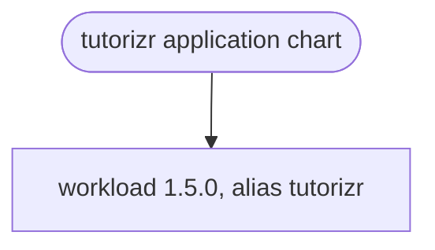

# tutorizr

The application umbrella chart for the tutorizr Signal tutor and learner MCP host. It configures
one `workload` dependency under the `tutorizr` alias, with a single-subscriber rollout strategy.

## Install from Source

Chart publication is disabled in the current repository workflow; use the source chart rather than
assuming a published tutorizr OCI version. Supply an application image built from a compatible source
revision: the host's Release dependency wiring is incomplete, as described in the
[host guide](https://github.com/f2calv/tutorizr/blob/main/src/CasCap.App.Server/README.md).
The checked-in chart and app versions are `0.1.0`, not evidence of a working released image.

With Helm 3, dependency-registry access and a deliberately selected Kubernetes context:

```powershell
helm dependency build .\charts\tutorizr
helm upgrade --install example-tutor .\charts\tutorizr --namespace example-tutor --create-namespace --values .\example-values.yaml
```

Create `example-values.yaml` from the fragment below plus the required deployment settings.
The commands fetch the dependency and change the selected cluster; they are not a local application
startup recipe.

## Configuration

| Value | Default | Effect |
| --- | --- | --- |
| `tutorizr.replicaCount` | `0` | The umbrella schema permits only 0 or 1; one subscriber per group |
| `tutorizr.strategy` | RollingUpdate, `maxSurge: 0`, `maxUnavailable: 1` | Replaces the old pod before starting its replacement |
| `tutorizr.image.repository` | `ghcr.io/f2calv/tutorizr` | Image reference; availability is not guaranteed by this default |
| `tutorizr.image.tag` | empty | Supply an explicit usable image tag |
| `tutorizr.service` | ClusterIP, port 80 → 8080 | Internal HTTP service |
| `tutorizr.envVars.CasCap__FeatureConfig__EnabledFeatures` | `Comms,Mcp` | Both application features |
| `tutorizr.startupProbe`, `readinessProbe`, `livenessProbe` | HTTP `/healthz` on 8080 | Application health endpoint |
| `tutorizr.resources` | Requests 50m CPU/192Mi; limits 1000m CPU/512Mi | Workload resource budget |

Zero replicas suppress the dependency's Deployment and Service. It is not a blanket resource
disable switch: independently enabled dependency resources, such as a ServiceAccount, can still
render. Preserve the non-overlapping strategy when enabling Comms.

Non-secret merge fragment:

```yaml
tutorizr:
  replicaCount: 1
  image:
    repository: ghcr.io/example/tutor
    tag: "0.1.0-example"
  envVars:
    AppConfig__KeyVaultName: skip
    CasCap__CachingConfig__RemoteCacheConnectionString: redis.example.com:6379,abortConnect=false
    CasCap__SignalizrClientConfig__BaseAddress: https://gateway.example.com
    CasCap__SignalizrClientConfig__GrpcAddress: https://gateway.example.com:5001
    CasCap__AgentRuntimeClientOptions__BaseAddress: https://runtime.example.com
```

This is not a complete chat deployment. Supply exact gateway group/subscriber settings, a runtime
agent definition and execution authentication, and MCP Basic credentials via secret-backed
configuration. Configure ingress/TLS if the runtime reaches MCP outside the cluster.
Never put credentials, certificates or API keys in chart values; use Kubernetes Secrets or the
host's configured Key Vault path.

The full values contract belongs to
[`values.yaml`](https://github.com/f2calv/tutorizr/blob/main/charts/tutorizr/values.yaml),
the umbrella
[schema](https://github.com/f2calv/tutorizr/blob/main/charts/tutorizr/values.schema.json)
and the dependency's
[values reference](https://github.com/f2calv/helm-charts/blob/workload/1.5.0/charts/workload/README.md).

## Dependency Graph



The dependency is pinned to `workload` `1.5.0` from `oci://ghcr.io/f2calv/charts` in
[`Chart.yaml`](https://github.com/f2calv/tutorizr/blob/main/charts/tutorizr/Chart.yaml).
There is no tracked `Chart.lock` in this checkout. The chart owns no templates of its own and bundles
neither Redis, the Signal gateway nor the Agent Runtime. Its `.helmignore` excludes `ci/`,
`.git/`, `.github/` and `.copilot-tracking/` from packaging.
