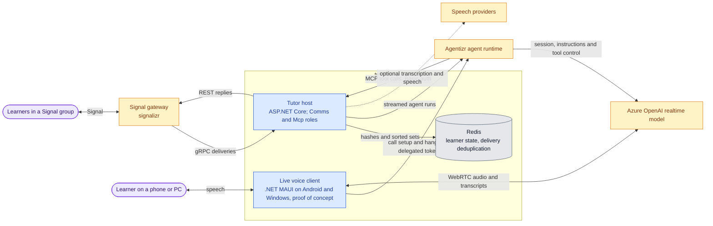
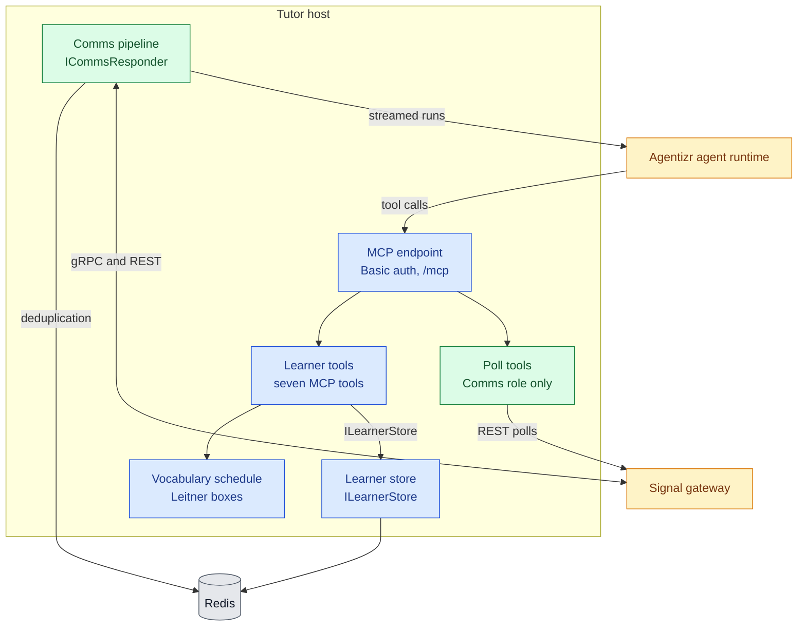
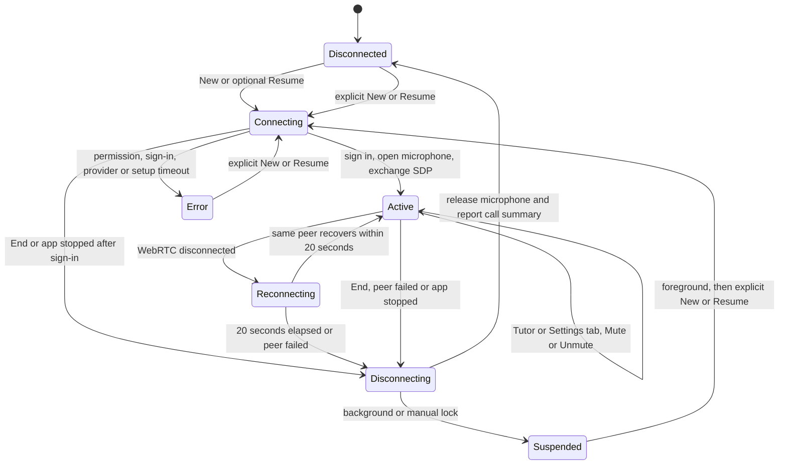
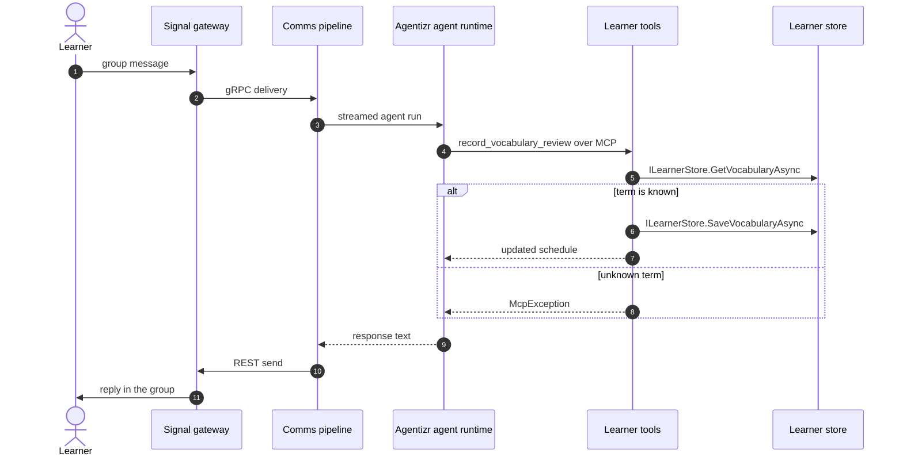
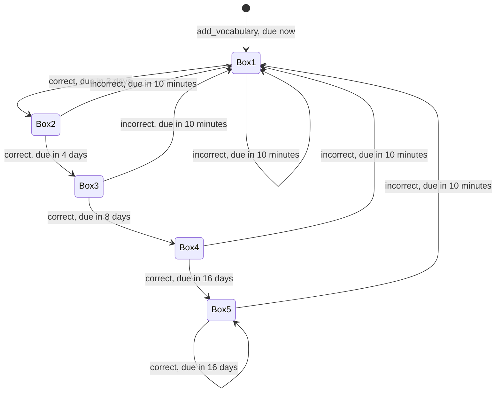
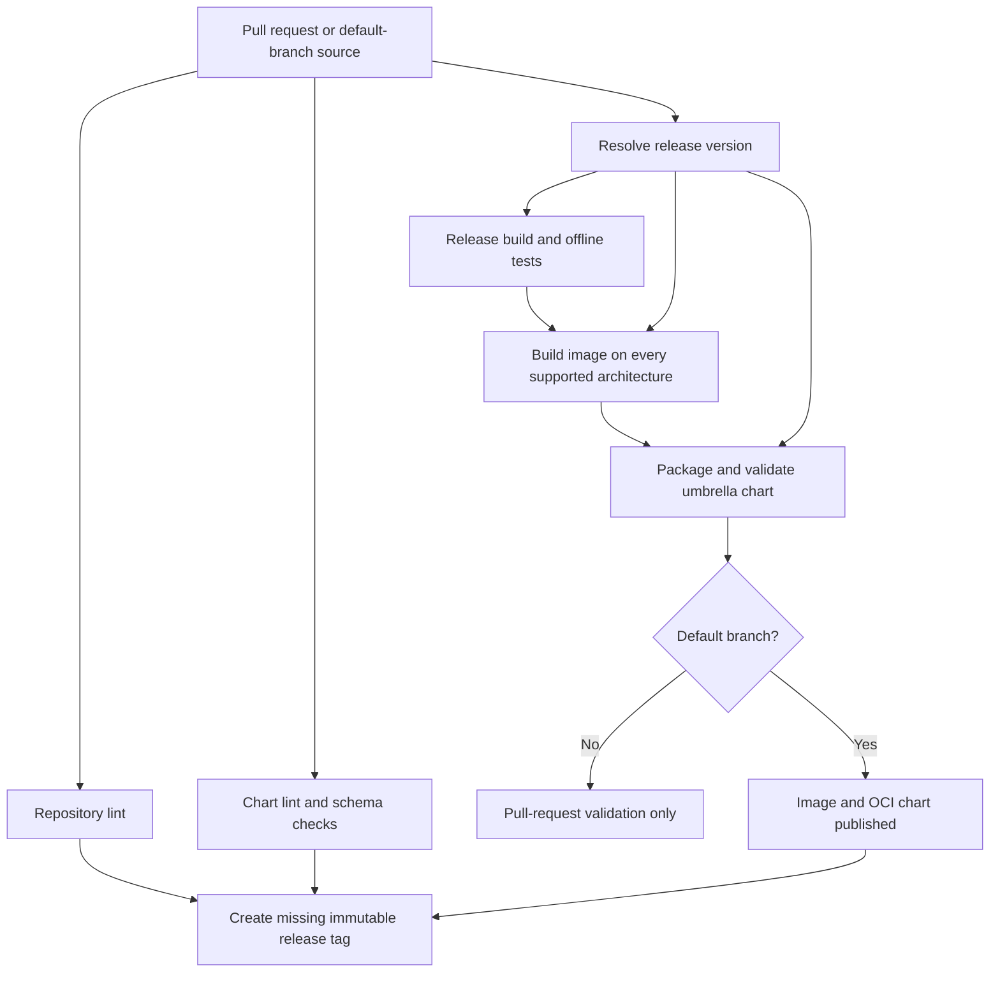

# Architecture

This drilldown opens the tutorizr host from the [System Context](../README.md#system-context) into its
containers and components, then follows one learner turn and the spaced-repetition lifecycle.
Teaching behaviour, persona and subject live in the tutor's agent definition in the
[Agentizr agent runtime](https://github.com/f2calv/agentizr/blob/1.6.0/docs/architecture.md), not in
this host, so the same containers serve any subject; the German tutor is only the first example.

## Containers

One image provides the host. `CasCap:FeatureConfig:EnabledFeatures` selects the `Comms` role, the
`Mcp` role or both; the [chart](../charts/tutorizr/README.md) runs a single replica so only one Comms
subscriber exists. Redis holds the learner state and the communications pipeline's delivery state.
The live voice client is a separate Android and Windows application and is not deployed by the chart.

The client signs the learner in through its public client registration and posts a WebRTC offer to
Agentizr's realtime calls endpoint ([agentizr#29](https://github.com/f2calv/agentizr/pull/29)). Agentizr
applies the tutor definition, negotiates the call with Azure OpenAI and runs the learner tools over the
same MCP endpoint the chat channel uses. The client never sees instructions, tool calls or provider
credentials.

## Host Components

The host owns the learner tools and their store. The communications pipeline and poll tools come
from the [`CasCap.Comms.AI` package](https://github.com/f2calv/signalizr/blob/1.3.0/src/CasCap.Comms.AI/README.md)
published by signalizr; this repository only registers them. `AppHost` is the composition root that
wires the components below by feature.

Blue components are implemented here; green components are registered from the `CasCap.Comms.AI`
package.

## Code Map

| Component | Responsibility | Code location | Provides | Requires |
| --- | --- | --- | --- | --- |
| MCP endpoint | Stateless Streamable HTTP with Basic authentication; rejects browser origins | `src/CasCap.App.Server/AppHost.WebApi.cs`, `AppHost.Endpoints.cs` | `/mcp`, `/healthz` | `ApiAuthConfig` |
| Learner tools | Validates and bounds tool input, returns structured learner results | `Services/TutorMcpQueryService.cs`, `Models/` | Seven `[McpServerTool]` methods | `ILearnerStore`, Vocabulary schedule, `TimeProvider` |
| Vocabulary schedule | Normalizes terms and computes Leitner review transitions | `Services/VocabularySchedule.cs` | `CreateNew`, `Review`, `Normalise` | None |
| Learner store | Persists level, vocabulary and a bounded mistake window | `Abstractions/ILearnerStore.cs`, `Services/RedisLearnerStore.cs` | `ILearnerStore` | Redis |
| Comms pipeline | Subscribes to the chat group, deduplicates, runs agent turns and queues replies | `CasCap.Comms.AI` package, registered in `AppHost.Features.cs` | [`ICommsResponder`](https://github.com/f2calv/signalizr/blob/1.3.0/src/CasCap.Comms/Abstractions/ICommsResponder.cs) | Signal gateway, [`IAgentRuntimeClient`](https://github.com/f2calv/agentizr/blob/1.6.0/src/CasCap.AgentRuntime.Client/Abstractions/IAgentRuntimeClient.cs), Redis |
| Poll tools | Creates and reads chat-group polls for the agent | `CasCap.Comms.AI` package, registered in `AppHost.Features.cs` when `Comms` is enabled | Poll `[McpServerTool]` methods | Signal gateway |
| Voice call page | Signs in before media starts, manages foreground keep-awake and stop/resume, exchanges SDP and displays transient transcripts | `src/CasCap.App.Maui/Pages/ConversationPage.xaml.cs`, `Services/TutorCallService.cs`, `TutorApp.xaml.cs` | New, Resume, Mute and End | Agent Runtime realtime call methods, `MsalAccessTokenProvider`, window lifecycle and MAUI `DeviceDisplay` |
| Call media | Opens the microphone, plays tutor audio, forwards transcripts and allows twenty seconds for a transient disconnect to recover | `src/CasCap.App.Maui/Resources/Raw/wwwroot/index.html` | `createOffer`, `acceptAnswer`, `setMuted`, `hangUp` | Platform microphone permission and WebRTC |

## Voice Call Lifecycle

Foreground calls keep the screen awake without changing the device timeout setting. Settings-tab
navigation preserves the call; actually backgrounding or manually locking the app ends media and
requires an explicit New or Resume action on return, never an automatic microphone restart.

Keep-awake applies while connecting after sign-in, active or reconnecting, and only while the app
window is foregrounded. It is released immediately on end, error, deactivation or suspension.
It prevents automatic screen-off, not the power button, operating-system policy or process death.
Interactive sign-in deliberately opens the system browser before media capture, so that expected
background transition does not cancel sign-in. Switching tabs does not call hang-up.

| Event | Behaviour |
| --- | --- |
| New | Creates a new model conversation; the retention switch is off by default |
| Resume | Opens a new WebRTC connection with the last retained voice context, not a continuation of an old audio socket |
| Temporary disconnect | Displays Reconnecting and keeps the existing peer for up to 20 seconds; repeated disconnect notifications do not restart the deadline |
| Recovery within the deadline | Returns to Listening; it neither creates a call nor replays history |
| Terminal failure or elapsed deadline | Ends the runtime call, releases media, reports the lost connection and enables New or Resume |
| End during setup | Cancels setup, waits for it to settle and ends any call created during the race |
| App stopped or manually locked | Releases keep-awake, closes media, requests runtime hang-up and leaves an explicit resume opportunity |
| Reactivation | Does not reopen the microphone; the learner presses Resume or New |
| Settings tab | Does not end the call; updated connection settings apply to a subsequent call |
| App killed | No client shutdown callback is guaranteed; the runtime's existing call ceiling/control-loss policy still applies |

Hang-up requests have a ten-second client deadline. If the network is unavailable, the UI reports
that the connection was lost; closing local media does not prove that the server received the
request. Provider/control loss or the runtime's existing maximum duration remains the fallback.

### Optional Conversation Continuity

The retention switch opts into server-side voice text retention. Agentizr stores at most 40
utterances and 32,768 characters for 24 hours after the last retained utterance or interruption.
No audio or raw tool outputs are retained; interrupted assistant utterances are omitted rather
than replaying words the learner may not have heard. This is bounded conversational continuity,
not lossless audio replay or an unlimited transcript archive.

The device stores only an opaque conversation reference scoped to the endpoint and configured
tutor profile, so Resume can survive an app restart. The server independently checks the validated
tenant, issuer and user identity, active definition and expiry. A missing, foreign, busy, expired
or definition-incompatible conversation is an explicit conflict, never a silently fresh session.
New replaces the device's last reference after successful setup; older server projections expire
normally. The local transcript display remains transient and is not restored from the server.

Knowledge-enabled calls do **not** support retention or Resume: replaying previous grounded
answers could bypass evidence expiry or revocation. They remain ordinary non-retained calls with
the switch off. Voice context also stays separate from text-session history.

This feature requires the matching Agentizr contracts, client and server changes before rollout.
Debug uses the adjacent runtime checkout; the Release package pin must be advanced through the
normal release train before producing a feature APK. Existing released servers cannot provide
conversation continuity.

### Verification

`node --test tests/call-media.test.cjs` exercises the exact twenty-second boundary, repeated
disconnects, recovery, terminal failure, stale callbacks, hang-up cleanup and late microphone
permission completion without a device or Azure. Agentizr's focused tests cover bounded replay,
provider acceptance, durable PostgreSQL state, ownership and expiry.

Device acceptance still needs a real call: leave it idle beyond the device timeout, switch between
Tutor and Settings, manually lock/unlock, recover a brief network loss, exceed twenty seconds and
resume after restarting the app. No automated test claims to prove Android vendor power management
or live model recall.

## Runtime Scenarios

### Learner Turn with a Tool Call

The tutor agent decides which learner tools to call; the host only persists and returns data.

## Spaced-Repetition Lifecycle

A term, word, fact or other recall item moves through five Leitner boxes. The interval waited after
a correct answer depends on the box the term reaches.

## Publication Flow

The [CI workflow](../.github/workflows/ci.yml) validates pull requests without publishing images
or charts. On the default branch it publishes both artifacts before creating the immutable release.
Publication does not install the chart or deploy the host.

Separate MAUI jobs publish Android and Windows packages. Same-repository human pull requests also
build and sign a sideload APK with the configured keystore; these are packaging runs, not compile-only
validation. The shared Android workflow skips Dependabot entirely, including the unsigned-bundle
job. Packaging and signing permission must therefore be established before triggering this workflow.

