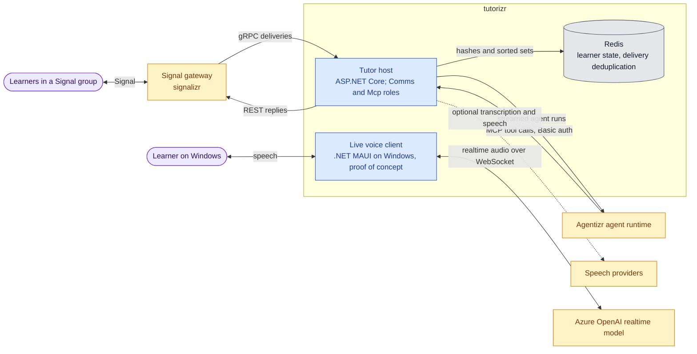
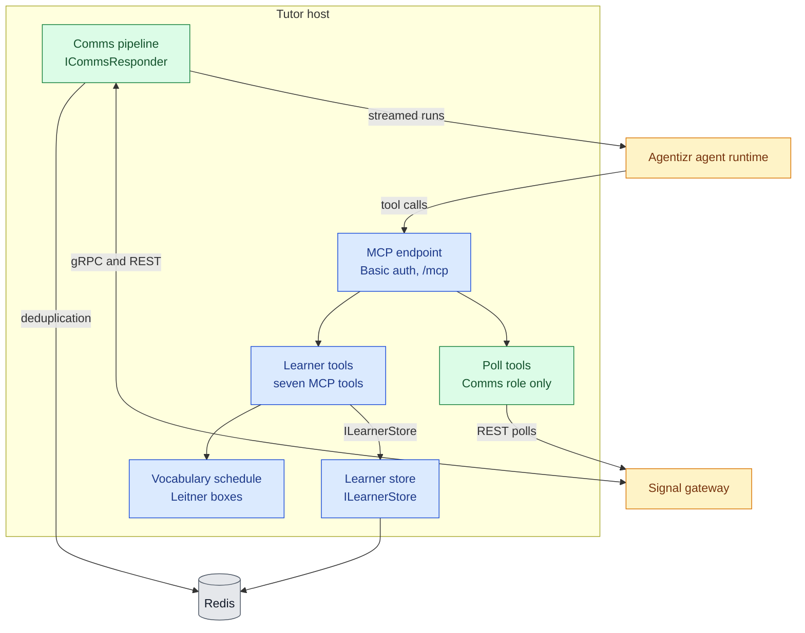
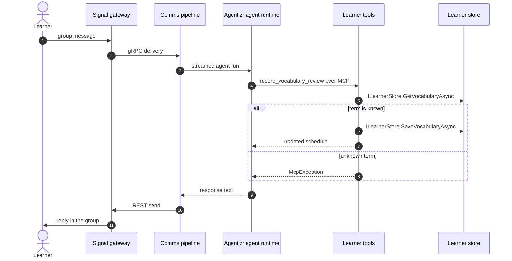
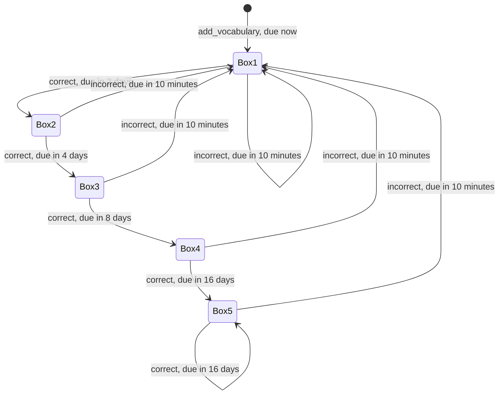
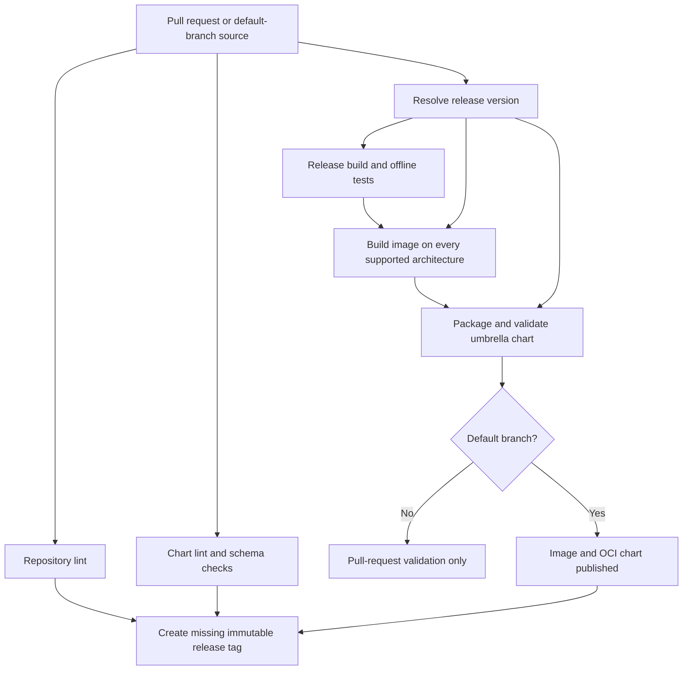

# Architecture

This drilldown opens the tutorizr host from the [System Context](../README.md#system-context) into its
containers and components, then follows one learner turn and the spaced-repetition lifecycle.
Teaching behaviour, persona and subject live in the tutor's agent definition in the
[Agentizr agent runtime](https://github.com/f2calv/agentizr/blob/1.4.0/docs/architecture.md), not in
this host, so the same containers serve any subject; the German tutor is only the first example.

## Containers

One image provides the host. `CasCap:FeatureConfig:EnabledFeatures` selects the `Comms` role, the
`Mcp` role or both; the [chart](../charts/tutorizr/README.md) runs a single replica so only one Comms
subscriber exists. Redis holds the learner state and the communications pipeline's delivery state.
The live voice client is a separate Windows application and is not deployed by the chart.

The client currently authenticates to Azure OpenAI with the signed-in user's Microsoft Entra
identity and a local prompt. In the target design, proposed in
[agentizr#29](https://github.com/f2calv/agentizr/pull/29), the client posts a WebRTC offer to
Agentizr, which applies the tutor definition and executes learner tools on the client's behalf.

## Host Components

The host owns the learner tools and their store. The communications pipeline and poll tools come
from the [`CasCap.Comms.AI` package](https://github.com/f2calv/signalizr/blob/1.2.0/src/CasCap.Comms.AI/README.md)
published by signalizr; this repository only registers them. `AppHost` is the composition root that
wires the components below by feature.

Blue components are implemented here; green components are registered from the `CasCap.Comms.AI`
package.

## Code Map

| Component | Responsibility | Code location | Provides | Requires |
| --- | --- | --- | --- | --- |
| MCP endpoint | Stateless Streamable HTTP with Basic authentication; rejects browser origins | `src/CasCap.App.Server/AppHost.WebApi.cs`, `AppHost.Endpoints.cs` | `/mcp`, `/healthz` | `ApiAuthConfig` |
| Learner tools | Validates and bounds tool input, returns structured learner results | `Services/TutorMcpQueryService.cs`, `Models/` | Seven `[McpServerTool]` methods | `ILearnerStore`, Vocabulary schedule, `TimeProvider` |
| Vocabulary schedule | Normalizes terms and computes Leitner review transitions | `Services/VocabularySchedule.cs` | `CreateNew`, `Review`, `Normalise` | None |
| Learner store | Persists level, vocabulary and a bounded mistake window | `Abstractions/ILearnerStore.cs`, `Services/RedisLearnerStore.cs` | `ILearnerStore` | Redis |
| Comms pipeline | Subscribes to the chat group, deduplicates, runs agent turns and queues replies | `CasCap.Comms.AI` package, registered in `AppHost.Features.cs` | [`ICommsResponder`](https://github.com/f2calv/signalizr/blob/1.2.0/src/CasCap.Comms/Abstractions/ICommsResponder.cs) | Signal gateway, [`IAgentRuntimeClient`](https://github.com/f2calv/agentizr/blob/1.4.0/src/CasCap.AgentRuntime.Client/Abstractions/IAgentRuntimeClient.cs), Redis |
| Poll tools | Creates and reads chat-group polls for the agent | `CasCap.Comms.AI` package, registered in `AppHost.Features.cs` when `Comms` is enabled | Poll `[McpServerTool]` methods | Signal gateway |
| Realtime conversation | Streams microphone audio, plays replies as they arrive and truncates interrupted replies to what was heard | `src/CasCap.App.Realtime/Services/RealtimeConversation.cs` | `RealtimeConversation` | `IRealtimeAudioInput`, `IRealtimeAudioOutput`, `TokenCredential` |
| Windows audio | WASAPI capture in communications mode for echo cancellation, and streamed playback | `src/CasCap.App.Maui/Platforms/Windows/Services/` | `IRealtimeAudioInput`, `IRealtimeAudioOutput` | NAudio |

## Runtime Scenarios

### Learner Turn with a Tool Call

The tutor agent decides which learner tools to call; the host only persists and returns data.

## Spaced-Repetition Lifecycle

A term, word, fact or other recall item moves through five Leitner boxes. The interval waited after
a correct answer depends on the box the term reaches.

## Publication Flow

The [CI workflow](../.github/workflows/ci.yml) validates pull requests without publishing images
or charts. On the default branch it publishes both artifacts before creating the immutable release.
Publication does not install the chart or deploy the host.

