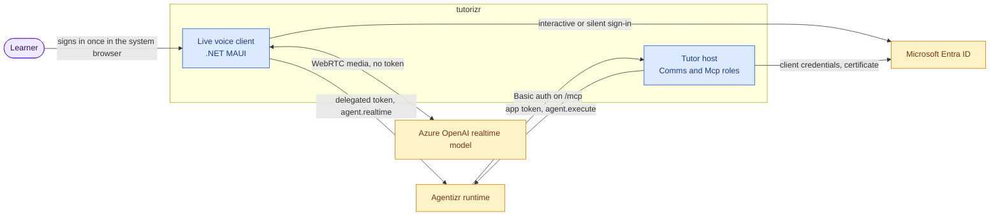
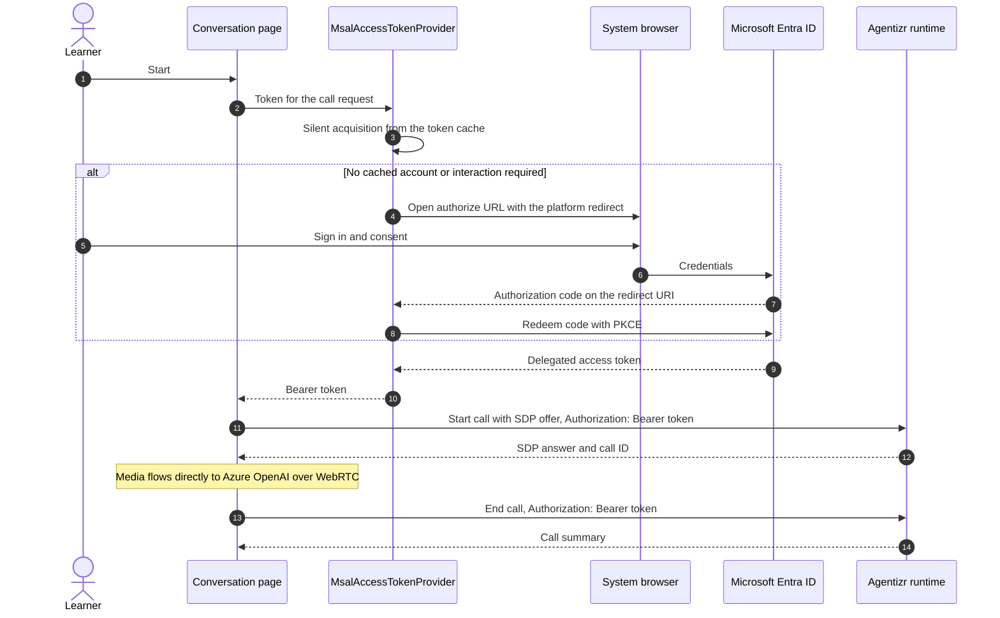
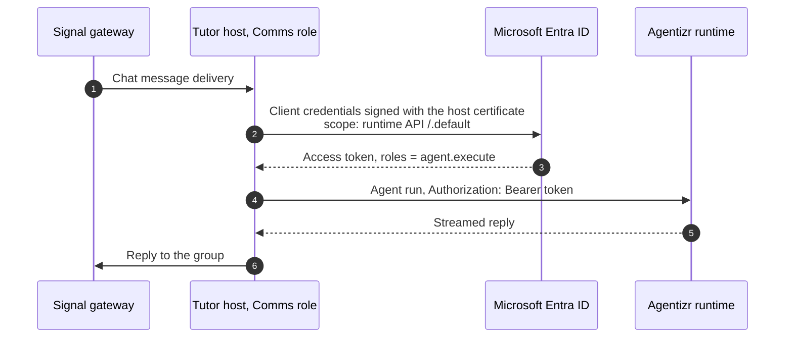

# Authentication

tutorizr has three authenticated connections: the live voice client signs a learner in and calls the
Agentizr runtime for them, the tutor host calls the runtime as itself, and the runtime calls the
host's learner tools. This page covers the tutorizr side of each. The runtime side, including how a
token is mapped to a tenant and which permission each endpoint needs, is described in
[Agentizr's authentication guide](https://github.com/f2calv/agentizr/blob/main/docs/authentication.md).
Every identifier on this page is a placeholder.

## Overview



| Connection | Who authenticates | Credential | Held by |
| --- | --- | --- | --- |
| Voice client to runtime | The learner | Delegated access token for `agent.realtime` | MSAL token cache in the client process |
| Tutor host to runtime | The host application | Access token for the `agent.execute` application role, from a certificate | The host's secret store |
| Runtime to tutor host | The runtime | Basic credentials on `/mcp` | The host's `ApiAuthConfig` and the runtime's tenant MCP credential |

## Voice Client Sign-In

The client is a public client: it holds no secret, so the learner's sign-in is what authorizes it.
[`MsalAccessTokenProvider`](../src/CasCap.App.Maui/Services/MsalAccessTokenProvider.cs) requests only
the delegated `agent.realtime` scope of the runtime API. It opens the system browser rather than an
embedded web view and uses no authentication broker. The browser returns to the app on the
`http://localhost` loopback redirect on Windows and on `io.github.f2calv.tutorizr://auth`, the
application ID, on Android.
[`BearerTokenHandler`](../src/CasCap.App.Maui/Services/BearerTokenHandler.cs) attaches the token to
every request the typed Agentizr client sends.



Only one interactive sign-in runs at a time; requests that wait for it retry the silent path first.
On Android MSAL keeps the token cache in app-private storage. On Windows the client stores it in a
file in its app data directory, encrypted with DPAPI for the signed-in Windows user, so a restart
signs in silently until the refresh token expires.

The token identifies the learner and the client registration. The runtime maps the registration's
client ID to the tutor's tenant and applies the tutor definition; the client never sends a tenant,
instructions or tools, and never receives a provider key, the ephemeral session secret or the
provider's call ID.

### Client Configuration

[`TutorClientConfig`](../src/CasCap.App.Maui/Models/_TutorClientConfig.cs) and the runtime address are
validated when the first call starts. On Windows they are read from .NET user secrets or
`tutorizr__`-prefixed environment variables. On Android the learner enters them on the Settings tab,
which stores them in app preferences, so an APK built in public CI carries none of them. None of these
values is a secret, but they identify a directory and a registration, so keep them out of tracked files.

Windows Debug also uses the shared
[`AddStandardConfiguration`](https://github.com/f2calv/CasCap.Common/blob/main/src/CasCap.Common.Configuration/Extensions/ConfigurationBuilderExtensions.cs)
loader. Its client-local base file is empty; it does not load the server's root settings.
Copy [the placeholder example](../src/CasCap.App.Maui/appsettings.Local.Development.json.example)
to `src/CasCap.App.Maui/appsettings.Local.Development.json` and replace every placeholder with
the approved voice-client registration and runtime settings:

```powershell
Copy-Item .\src\CasCap.App.Maui\appsettings.Local.Development.json.example .\src\CasCap.App.Maui\appsettings.Local.Development.json
```

The local file is gitignored and copied only to Windows Debug build output, never to publish
output, NuGet packages or Android assets. Do not distribute the Debug output directory.
The standard loader applies JSON sources first, then user secrets and unprefixed environment
variables; `tutorizr__` environment variables are added last and override all earlier sources.
An optional client-local `appsettings.Local.json` can supply overrides shared across environments.
Rebuild and restart after changing a local file; cached clients do not support live settings changes.
Windows Release keeps its existing user-secret and prefixed-environment configuration path.
No client secret, password, certificate or realtime provider key belongs in this client.

| Key | Purpose |
| --- | --- |
| `TutorClientConfig:TenantId` | Directory of the public client registration |
| `TutorClientConfig:ClientId` | Public client registration ID |
| `TutorClientConfig:ApiScope` | Whitespace-separated delegated scopes for the same runtime API; existing single-scope settings remain valid |
| `TutorClientConfig:AgentName` | Agent whose definition offers realtime calls |
| `CasCap:AgentRuntimeClientOptions:BaseAddress` | Runtime base address, for example `https://runtime.example.com/` |

On Windows:

```powershell
dotnet user-secrets --project src/CasCap.App.Maui set "TutorClientConfig:TenantId" "00000000-0000-0000-0000-000000000000"
dotnet user-secrets --project src/CasCap.App.Maui set "TutorClientConfig:ClientId" "00000000-0000-0000-0000-000000000000"
dotnet user-secrets --project src/CasCap.App.Maui set "TutorClientConfig:ApiScope" "api://00000000-0000-0000-0000-000000000000/agent.realtime"
dotnet user-secrets --project src/CasCap.App.Maui set "TutorClientConfig:AgentName" "TutorAgent"
dotnet user-secrets --project src/CasCap.App.Maui set "CasCap:AgentRuntimeClientOptions:BaseAddress" "https://runtime.example.com/"
```

The public client registration needs a mobile and desktop platform with the `http://localhost` and
`io.github.f2calv.tutorizr://auth` redirect URIs, the delegated `agent.realtime` permission on the
runtime API, and its client ID added to the tutor tenant's caller list in the runtime.

For knowledge-enabled voice calls, register and consent `agent.knowledge.search` first, then enter
both fully qualified scopes in the existing scope setting:

```text
api://00000000-0000-0000-0000-000000000000/agent.realtime api://00000000-0000-0000-0000-000000000000/agent.knowledge.search
```

The client splits whitespace and removes duplicate entries before both silent and interactive
MSAL requests. It requests one token containing both permissions, not two tokens.
No extra scope is automatically added to ordinary calls. After saving settings, restart the app
if it has already started a call; interactive sign-in may be required for the expanded permission.
The server still requires the operator's A1 binding and an opted-in tutor definition. Client
compilation and offline parsing tests do not prove actual token claims or a live grounded lesson.

A self-hosted runtime behind a private certificate authority needs that authority installed on the
phone as a user certificate. The Android app trusts user-installed authorities as well as system
ones so it can reach such a runtime; it accepts no cleartext traffic.

## Tutor Host To Runtime

When the `Comms` role relays a chat message, the host calls the runtime as itself through
`AddAgentRuntimeAzureAuthentication`. It uses the client credentials flow with a certificate from its
own app registration, which holds only the `agent.execute` application role. The settings bind from
`CasCap:AgentRuntimeAzureAuthConfig` (`Enabled`, `TenantId`, `ClientId`, `Certificate` and `Scope`);
tracked configuration leaves them disabled and empty, and a deployment supplies them from its secret
store.



## Runtime To Tutor Host

The `Mcp` role exposes the learner tools at `/mcp`. The endpoint requires Basic authentication from
`CasCap:ApiAuthConfig` and rejects any request with an `Origin` header with `403`, because the
runtime sends none and a browser always does. The runtime holds the matching credential as a
tenant MCP credential and sends it only on calls to this host, both for chat runs and for realtime
call tools. Learner calls additionally require a login identity captured by the runtime during
realtime call setup, independently of conversation retention.

Enable `callerIdentityEnabled: true` on the learner `ToolSource` in the runtime definition, with
its endpoint credential and explicit learner-tool allowlists. This is opt-in per trusted source;
the runtime does not send caller identity to other MCP endpoints. It requires validated delegated
`scp`, issuer and subject claims, preferring Entra `oid` over client-specific `sub`. The runtime
hashes a versioned, unambiguous tuple of app tenant, issuer and subject into a lowercase SHA-256
`X-AgentRuntime-Caller-Id` header, captured once for the call. The login is not a tool argument,
email address, conversation ID or device ID.

Tutorizr trusts this header only after Basic authentication and requires exactly one 64-character
lowercase hex value. The runtime credential is the assertion trust boundary: anyone holding it
can impersonate a caller, so keep it secret and use HTTPS outside isolated loopback.
Each Redis key ends with this opaque identity. Missing identity fails the learner tool before any
learner data command; there is no shared profile fallback. Signal's machine identity is admin/debug-only
and cannot access learner state. Old shared keys are left untouched and unused.

```mermaid
sequenceDiagram
    autonumber
    participant Runtime as Agentizr runtime
    participant Mcp as Tutor host /mcp
    participant Tools as Learner tools

    Runtime->>Mcp: Tool call, Basic credentials and opaque login context
    alt Credentials invalid
        Mcp-->>Runtime: 401 Unauthorized
    else Origin header present
        Mcp-->>Runtime: 403 Forbidden
    else Authorized
        alt Learner identity missing or malformed
            Mcp-->>Runtime: Learner tool error; no learner data access
        else Valid learner identity
            Mcp->>Tools: Invoke tool with request-owned learner context
            Tools-->>Mcp: Structured result
            Mcp-->>Runtime: Tool result
        end
    end
```

The tools trust the runtime to have authorized the login; they never log
learner content, and they bound list sizes and text lengths themselves.
