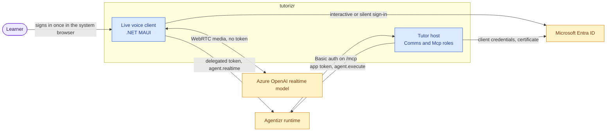
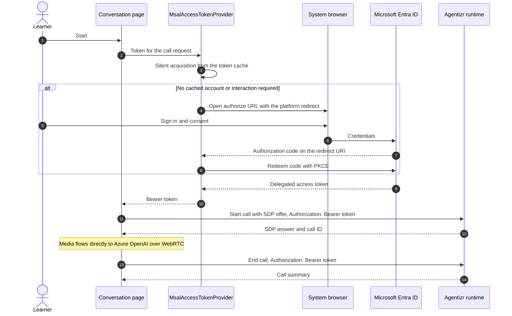
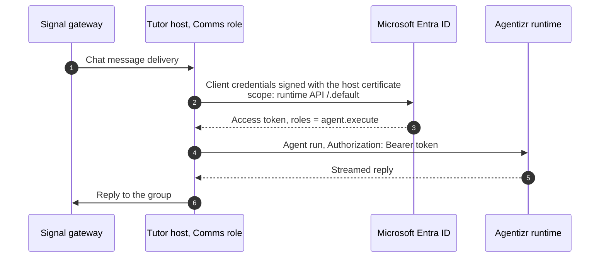
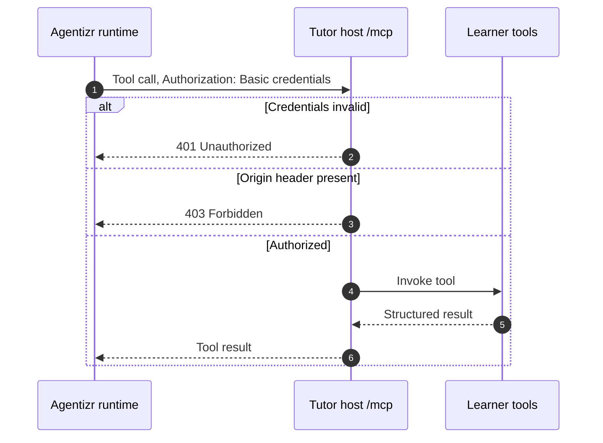

# Authentication

tutorizr has three authenticated connections: the live voice client signs a learner in and calls the
Agentizr runtime for them, the tutor host calls the runtime as itself, and the runtime calls the
host's learner tools. This page covers the tutorizr side of each. The runtime side, including how a
token is mapped to a tenant and which permission each endpoint needs, is described in
[Agentizr's authentication guide](https://github.com/f2calv/agentizr/blob/main/docs/authentication.md).
Every identifier on this page is a placeholder.

## Overview



| Connection | Who authenticates | Credential | Held by |
| --- | --- | --- | --- |
| Voice client to runtime | The learner | Delegated access token for `agent.realtime` | MSAL token cache in the client process |
| Tutor host to runtime | The host application | Access token for the `agent.execute` application role, from a certificate | The host's secret store |
| Runtime to tutor host | The runtime | Basic credentials on `/mcp` | The host's `ApiAuthConfig` and the runtime's tenant MCP credential |

## Voice Client Sign-In

The client is a public client: it holds no secret, so the learner's sign-in is what authorizes it.
[`MsalAccessTokenProvider`](../src/CasCap.App.Maui/Services/MsalAccessTokenProvider.cs) requests only
the delegated `agent.realtime` scope of the runtime API. It opens the system browser rather than an
embedded web view and uses no authentication broker. The browser returns to the app on the
`http://localhost` loopback redirect on Windows and on `io.github.f2calv.tutorizr://auth`, the
application ID, on Android.
[`BearerTokenHandler`](../src/CasCap.App.Maui/Services/BearerTokenHandler.cs) attaches the token to
every request the typed Agentizr client sends.



Only one interactive sign-in runs at a time; requests that wait for it retry the silent path first.
On Android MSAL keeps the token cache in app-private storage; on Windows the cache lives in memory, so
restarting the client prompts again.

The token identifies the learner and the client registration. The runtime maps the registration's
client ID to the tutor's tenant and applies the tutor definition; the client never sends a tenant,
instructions or tools, and never receives a provider key, the ephemeral session secret or the
provider's call ID.

### Client Configuration

[`TutorClientConfig`](../src/CasCap.App.Maui/Models/_TutorClientConfig.cs) and the runtime address are
validated when the first call starts. On Windows they are read from .NET user secrets or
`tutorizr__`-prefixed environment variables. On Android the learner enters them on the Settings tab,
which stores them in app preferences, so an APK built in public CI carries none of them. None of these
values is a secret, but they identify a directory and a registration, so keep them out of tracked files.

| Key | Purpose |
| --- | --- |
| `TutorClientConfig:TenantId` | Directory of the public client registration |
| `TutorClientConfig:ClientId` | Public client registration ID |
| `TutorClientConfig:ApiScope` | Delegated scope, for example `api://00000000-0000-0000-0000-000000000000/agent.realtime` |
| `TutorClientConfig:AgentName` | Agent whose definition offers realtime calls |
| `CasCap:AgentRuntimeClientOptions:BaseAddress` | Runtime base address, for example `https://runtime.example.com/` |

On Windows:

```powershell
dotnet user-secrets --project src/CasCap.App.Maui set "TutorClientConfig:TenantId" "00000000-0000-0000-0000-000000000000"
dotnet user-secrets --project src/CasCap.App.Maui set "TutorClientConfig:ClientId" "00000000-0000-0000-0000-000000000000"
dotnet user-secrets --project src/CasCap.App.Maui set "TutorClientConfig:ApiScope" "api://00000000-0000-0000-0000-000000000000/agent.realtime"
dotnet user-secrets --project src/CasCap.App.Maui set "TutorClientConfig:AgentName" "TutorAgent"
dotnet user-secrets --project src/CasCap.App.Maui set "CasCap:AgentRuntimeClientOptions:BaseAddress" "https://runtime.example.com/"
```

The public client registration needs a mobile and desktop platform with the `http://localhost` and
`io.github.f2calv.tutorizr://auth` redirect URIs, the delegated `agent.realtime` permission on the
runtime API, and its client ID added to the tutor tenant's caller list in the runtime.

A self-hosted runtime behind a private certificate authority needs that authority installed on the
phone as a user certificate. The Android app trusts user-installed authorities as well as system
ones so it can reach such a runtime; it accepts no cleartext traffic.

## Tutor Host To Runtime

When the `Comms` role relays a chat message, the host calls the runtime as itself through
`AddAgentRuntimeAzureAuthentication`. It uses the client credentials flow with a certificate from its
own app registration, which holds only the `agent.execute` application role. The settings bind from
`CasCap:AgentRuntimeAzureAuthConfig` (`Enabled`, `TenantId`, `ClientId`, `Certificate` and `Scope`);
tracked configuration leaves them disabled and empty, and a deployment supplies them from its secret
store.



## Runtime To Tutor Host

The `Mcp` role exposes the learner tools at `/mcp`. The endpoint requires Basic authentication from
`CasCap:ApiAuthConfig` and rejects any request with an `Origin` header with `403`, because the
runtime sends none and a browser always does. The runtime holds the matching credential as a
tenant MCP credential and sends it only on calls to this host, both for chat runs and for realtime
call tools.



The tools trust the runtime to have authorized the learner or the chat group; they never log
learner content, and they bound list sizes and text lengths themselves.
